# TAKEOUT // X-RAY v2.0

**100% client-side, zero-backend personal data forensics engine for 12 platforms (13 export formats) — with streaming `.zip` ingestion, DuckDB-Wasm SQL, service-adapted telemetry, and anonymized 1080×1350 Wrapped exports.**

[**Launch Live App → wioledead.github.io/takeout-xray**](https://wioledead.github.io/takeout-xray/)

Drag and drop raw `.zip` archives, folders, or massive JSON/JSONL/JS/TXT exports directly into your browser (`Antigravity 2.0`, `Claude Code CLI`, `ChatGPT`, `Claude.ai`, `Telegram`, `WhatsApp`, `Discord`, `X / Twitter`, `Spotify`, `YouTube`, `TikTok`, `Google Chrome`). Not a single byte of your data ever leaves your device.

### v2 Walkthrough: 12-Service Grid, Export Guides & Service-Adapted Forensics


### Specialized Lenses (AI Agents, Spotify, X/Twitter), Live DuckDB SQL & Wrapped Audit


---

## Privacy & Streaming Architecture Guarantees

- **Zero Backend / Self-Hosted DuckDB-Wasm:** Everything runs locally inside your browser tab via Dedicated Web Worker + self-hosted DuckDB-Wasm assets (no runtime CDN scripts or `.wasm` downloads), enforced by a strict Content Security Policy (`connect-src 'self' data: blob:`).
- **Streaming `.ZIP` Central-Directory Slicing:** Multi-gigabyte Takeout / Discord / X / ChatGPT `.zip` bundles are inspected once per archive without extracting heavy media folders (`@zip.js/zip.js` with external workers disabled), and multi-service Google Takeout `.zip` archives let you pick each dataset interactively.
- **Zero Full-File `JSON.parse()`:** Huge logs are streamed incrementally with `ReadableStream` (`file.stream().getReader()`) and `@streamparser/json` inside `src/worker/xray.worker.ts`. Official X / Twitter `window.YTD.<type>.partN = [...]` wrappers are stripped on the fly via constant-memory byte streaming.
- **Folder Smart Deduplication:** Dropping local agent directories (like `~/.gemini/antigravity/brain` or `~/.claude/projects`) automatically selects `transcript_full.jsonl` over `transcript.jsonl` and deduplicates streaming chunk usage by `message.id`.
- **DuckDB-Wasm Memory Hygiene & SQL Sandbox:** Events, agent steps, and media/social telemetry flush in `5,000`-row NDJSON batches using `db.registerFileText(...)` + `read_json(...)` and are immediately cleaned up with `await db.dropFile(...)`. User SQL queries are restricted to read-only statements with external file/URL functions blocked and extension autoloading disabled after startup.
- **No `COOP / COEP` Headers Required:** Deploys cleanly on any static host (GitHub Pages, Cloudflare Pages, Netlify, Vercel).
- **Live Network Telemetry Audit:** Built-in `PerformanceObserver` + `fetch`/`XHR`/`sendBeacon` monitors across both the main thread and the analysis worker keep a live `0 B SENT AFTER LOAD` indicator with an inspectable audit modal.

```mermaid
flowchart LR
    Drop["Raw .zip / Folder / JSON / JS / JSONL / TXT"] -->|"Central-dir slice / Stream"| Detector["4MB Prefix Signature Sniffer (13 Formats)"]
    Detector -->|"Strip YTD / Stream Parse"| Worker["Streaming Adapters (Web Worker)"]
    Worker -->|"5,000-row NDJSON batch"| VFS["db.registerFileText -> read_json -> db.dropFile"]
    VFS --> DuckDB["DuckDB-Wasm In-Browser SQL (4 Tables)"]
    DuckDB -->|"Archetype Profile (formatProfile.ts)"| UI["Service-Adapted Cyber-Terminal Dashboard (EN / RU)"]
    UI -->|"html-to-image (client-side)"| PNG["Anonymizable 1080×1350 X-Ray Wrapped PNG"]
```



---

## Supported Platforms (12 Services · 13 Export Formats)

Built-in step-by-step **Export Guides (EN / RU)** are included directly inside the app UI.

| Category | Service | Expected Files / Input | Highlights |
| :--- | :--- | :--- | :--- |
| **AI Agents** | **Antigravity 2.0** | `brain/` folder, `transcript_full.jsonl`, `transcript.jsonl`, `.zip` | Token budgets, KV cache hit rate, thinking vs reply chars, tool call heatmap |
| **AI Agents** | **Claude Code CLI** | `~/.claude/projects/` folder, `<session-uuid>.jsonl`, `.zip` | Session telemetry, cache read efficiency, `Read`/`Edit`/`Bash` tool breakdown |
| **AI Chats** | **OpenAI ChatGPT** | `.zip` or `conversations.json` | Reconstructs active DAG branch + counts regenerated/abandoned branches & politeness |
| **AI Chats** | **Anthropic Claude.ai** | `.zip` or `conversations.json` | Extracts prompt/reply cadence, thinking-turn volume & code block density |
| **Messengers** | **Telegram Desktop** | `result.json` (`tg_chat` single chat & `tg_account` full account), `.zip` | 6h+ silence initiator index, true median reply speed, monologue streaks |
| **Messengers** | **WhatsApp** | `_chat.txt` / `WhatsApp Chat with *.txt` / `.zip` | Auto-detects iOS & Android + DMY/MDY dates, multiline messages, media omitted tags |
| **Messengers** | **Discord** | Official Data Package `.zip` / `messages/` or DiscordChatExporter `.json` | Resolves channel & DM names from `messages/index.json` + multi-channel stats |
| **Social** | **X (Twitter)** | Archive `.zip`, `data/tweets.js`, `like.js`, `direct-messages.js` | Streams `window.YTD.*` files, decodes Snowflake IDs for likes, clients & top posts ❤️ |
| **Media** | **Spotify** | `.zip` or `Streaming_History_Audio_*.json` / `StreamingHistory*.json` | Hours listened, skip/shuffle habits, artist obsession & top replayed tracks |
| **Media** | **YouTube** | Takeout `.zip` or `watch-history.json` | Unique channels, Shorts vs Long-Form ratio & channel binge-watch marathons |
| **Media** | **TikTok** | `.zip` or `user_data_tiktok.json` | Watched feed, like/watch conversion ratio, searches, sounds & `@creator` streaks |
| **Browser** | **Google Chrome** | Takeout `.zip` or `BrowserHistory.json` / `History.json` | `time_usec` precision, `TYPED`/`LINK`/`RELOAD` transitions & domain rabbit holes |

---

## Key Capabilities & Service-Adapted Forensics

1. **12 Instant Client-Side Demos & Bilingual UI (EN / RU):** Test every supported platform in 1 click using deterministic synthetic datasets directly from the 4×3 landing grid.
2. **Archetype-Aware Analytics (`formatProfile.ts`):** Metrics adapt to the platform archetype so chat-only metrics (like *6h Conversation Initiator*, *Median Reply Latency*, or *Monologue Streaks*) never appear on YouTube, Spotify, TikTok, Chrome, Coding Agents, or X/Twitter. Instead, each service surfaces domain-native breakdowns (`Channel Binge Marathons`, `Posting Style & Clients`, `Playback Skip vs Shuffle`, `Domain Rabbit Holes`, `Agent Tool Calls`).
3. **Circadian Matrix & Lexicon Engine:** 24×7 local timezone heatmap, stopwords-filtered EN/RU top vocabulary by year, Unicode emoji extractor, and specialized forensic lens cards.
4. **Live Read-Only DuckDB SQL Console:** Query `events`, `threads`, `antigravity_steps`, `media_events`, and `stopwords` directly in SQL with source-prioritized presets, 500-row DOM cap, and 1-click CSV copy.
5. **Anonymizable `1080×1350` X-Ray Wrapped Card:** Generate and download a shareable PNG summary customized for the active platform, with an **Anonymize Data** toggle that masks participant names (`Subject_01`), thread titles (`Thread_REDACTED`), top vocabulary (`word_01`), and browser domains (`domain_01.redacted`).

---

## Local Development & Verification

```bash
# Install dependencies
npm install

# Start Vite dev server
npm run dev

# Run TypeScript check
npm run typecheck

# Run Vitest unit & DuckDB-Wasm integration suite
npm test

# Build static production bundle
npm run build
```
