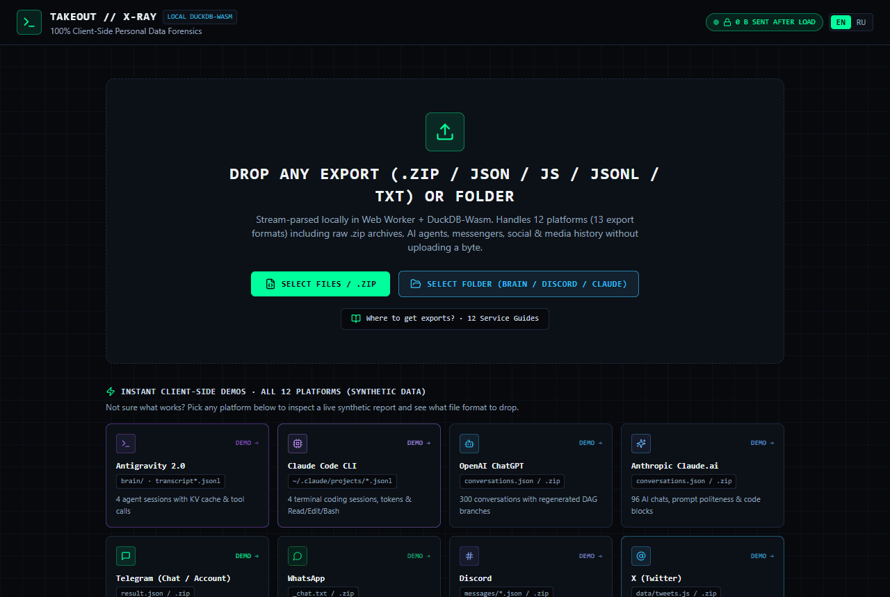
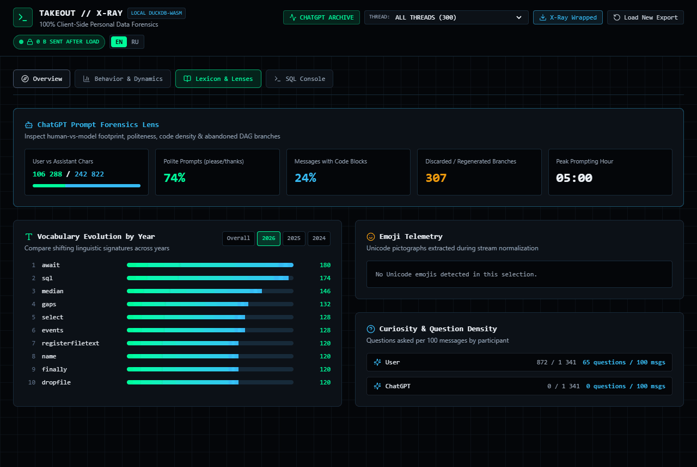

# TAKEOUT // X-RAY

**100% client-side, zero-backend personal data forensics & "Wrapped" telemetry generator.**

Drag and drop massive personal archive exports (Telegram Desktop, ChatGPT, or Google Takeout Chrome History) directly into your browser. Not a single byte of your data ever leaves your device.

### Overview, Circadian Heatmap & Behavioral Forensics



### ChatGPT DAG Lens, Live DuckDB SQL & Anonymized Wrapped Export



---

## Privacy & Architecture Guarantees

- **Zero Backend / Zero Upload:** Everything runs locally inside your browser tab.
- **Zero Full-File `JSON.parse()`:** Files exceeding 500 MB are read incrementally via `ReadableStream` (`file.stream().getReader()`) and `@streamparser/json` inside a dedicated Web Worker (`src/worker/xray.worker.ts`) without freezing the UI thread.
- **DuckDB-Wasm Hygiene:** Normalized events are flushed in `5,000`-row NDJSON batches using `db.registerFileText(...)` + `read_json(...)` and immediately cleaned up via `await db.dropFile(...)` to prevent WASM virtual filesystem memory leaks.
- **No `COOP / COEP` Headers Required:** Uses standard `mvp`/`eh` DuckDB-Wasm bundles (loaded once from jsDelivr CDN at initialization; user files never touch the network) with a same-origin Blob worker wrapper so it deploys cleanly on any static host (GitHub Pages, Cloudflare Pages, Netlify, Vercel).
- **Live Network Telemetry Audit:** Built-in `PerformanceObserver` + `fetch`/`XHR`/`sendBeacon` monitor displays live `0 B SENT AFTER LOAD` status with an inspectable audit modal.

```mermaid
flowchart LR
    File["Personal JSON Export (500MB+)"] -->|"file.stream().getReader()"| Detector["16KB Signature Sniffer"]
    Detector -->|"tg_chat / tg_account / chatgpt / chrome_history"| Parser["@streamparser/json (Web Worker)"]
    Parser -->|"5,000-row NDJSON batch"| VFS["db.registerFileText -> read_json -> db.dropFile"]
    VFS --> DuckDB["DuckDB-Wasm In-Browser SQL Engine"]
    DuckDB -->|"Typed RPC (postMessage)"| UI["React 19 Cyber-Terminal Dashboard"]
    UI -->|"html-to-image (client-side)"| PNG["1080×1350 X-Ray Wrapped PNG"]
```



---

## Supported Personal Data Formats

| Source | Export File | How to Export |
| :--- | :--- | :--- |
| **Telegram Desktop** | `result.json` (single chat or full account `chats.list`) | Telegram Desktop → Settings → Advanced → Export Telegram data (JSON format) |
| **OpenAI ChatGPT** | `conversations.json` (reconstructs active DAG branch + counts regenerated branches) | ChatGPT → Settings → Data controls → Export data |
| **Google Takeout Chrome** | `BrowserHistory.json` (`time_usec` precision & transition forensics) | [takeout.google.com](https://takeout.google.com) → Chrome → History (JSON) |

---

## Key Forensic Views

1. **Overview:** KPI telemetry cards, custom SVG **24×7 Circadian Activity Matrix**, adaptive temporal activity timeline, and entity volume breakdown.
2. **Behavior & Dynamics:**
   - **Conversation Initiator Index:** Who breaks 6+ hour silence gaps to restart dialogue.
   - **Median Response Latency:** True median reply cadence (excludes 6h+ sleep gaps & double-text bursts).
   - **Monologue Streaks:** Longest uninterrupted consecutive message chains per participant.
   - **Night Owl Index:** Late-night activity share (`00:00–05:00`) and peak hour.
3. **Lexicon & Specialized Lenses:**
   - Stopwords-filtered **Top Vocabulary** (EN + RU) and **Vocabulary Evolution by Year**.
   - Unicode **Emoji Telemetry** and **Question Curiosity Index**.
   - **ChatGPT Lens:** User vs Assistant character footprint, polite prompt density, code block ratio, and abandoned/regenerated DAG branches.
   - **Chrome Lens:** Top visited domains, `TYPED`/`LINK`/`RELOAD` transition breakdown, and single-domain rabbit-hole streaks.
4. **Live SQL Console:** Query normalized DuckDB tables (`events`, `threads`, `stopwords`) directly in a read-only sandbox with one-click forensic presets, schema sidebar, 500-row DOM cap, and CSV export.
5. **X-Ray Wrapped Modal:** Generate a `1080×1350` Cyber-Terminal PNG poster with an **Anonymize Names** toggle (`Subject_01`, `Subject_02`, `Thread_REDACTED`).

---

## Local Development & Verification

```bash
# Install dependencies
npm install

# Start Vite dev server
npm run dev

# Run TypeScript check
npm run typecheck

# Run Vitest unit & DuckDB integration suite
npm test

# Build static production bundle
npm run build
```
